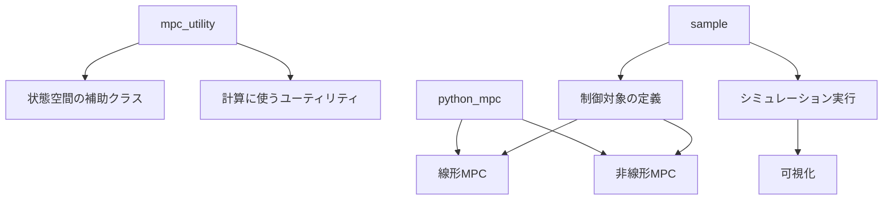
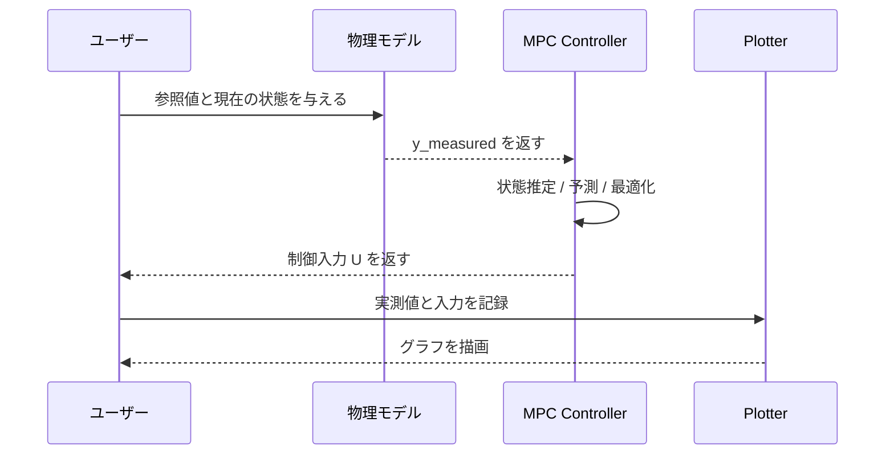

# 1. 概要と使い方の流れ

このリポジトリの目的は、MPCを「自分の制御問題に合わせて少しずつ組み立てられる」ようにすることです。

特に `sample/` 配下のスクリプトでは、次のような流れで動かします。

1. 物理モデルを数式で定義する
2. 離散時間の状態空間モデルに変換する
3. 重みや予測ホライズンを決める
4. MPCコントローラを生成する
5. 実際の計測値と目標値を渡して制御入力を得る
6. 波形として確認する

## 役割の分担



## どこが「使いやすい」設計なのか

ユーザーが実際に触るのは、ほぼ次の3つです。

- モデルを表す行列 `A, B, C`
- MPCを作るクラス `LTI_MPC_NoConstraints` / `NonlinearMPC_TwiceDifferentiable`
- 出力や参照入力を可視化する `SimulationPlotterDash`

この設計では、物理モデルの作り方よりも「制御ループの流れ」を意識しやすくなっています。

## 線形MPCと非線形MPCの違い

| パターン | 典型的な使いどころ | 代表的なクラス |
| --- | --- | --- |
| 線形システム | モデルが `A, B, C` の線形状態空間で表せる | `LTI_MPC_NoConstraints` |
| 非線形システム | ステート方程式や計測方程式が非線形 | `NonlinearMPC_TwiceDifferentiable` |

- 線形システムでは、`sample/lti_no_constraints/servo_motor.py` のように、制御対象を状態空間で定義して制御量を作るのが標準的です
- 非線形システムでは、`sample/nonlinear/simple_pendulum.py` のように、シンボリック変数を使って状態遷移 `f(x, u)` と観測 `h(x)` を定義します

## 典型的な制御ループ



## サンプルコードの読み方のコツ

サンプルコードは「最初から最後まで全部理解する」より、以下の3点だけ見れば十分です。

- どの変数が状態・入力・出力なのか
- どこで `reference` を与えているか
- どこで `update(...)` または `update_manipulation(...)` を呼んでいるか

たとえば `sample/lti_no_constraints/servo_motor.py` では、次の順番です。

```python
sys_d = sys.sample(Ts=dt, method='euler')
ideal_plant_model = SymbolicStateSpace(
    sys_d.A, sys_d.B, sys_d.C, delta_time=dt, Number_of_Delay=0
)

mpc = LTI_MPC_NoConstraints(
    ideal_plant_model, Np=20, Nc=2,
    Weight_U=Weight_U, Weight_Y=Weight_Y,
)

reference = np.array([[input_signal[i, 0]], [0.0]])
U = lti_mpc.update(reference, y_measured)
```

ここで重要なのは、MPCにとって「参考値」「現在の出力」「システムモデル」が入力になる点です。あとは内部で予測と最適化が行われ、制御入力が返ってくるという理解で十分です。

## まとめ

このリポジトリで大切なのは、MPCそのものの数式を丸ごと覚えることではなく、次の3ステップに慣れることです。

- モデルを作る
- MPCクラスを生成する
- `update` で制御入力を受け取る

次の章では、実際に使われている線形MPCのクラスとその呼び出し方を、サンプルに沿って見ていきます。

[02-linear-mpc-usage.md](./02-linear-mpc-usage.md)
