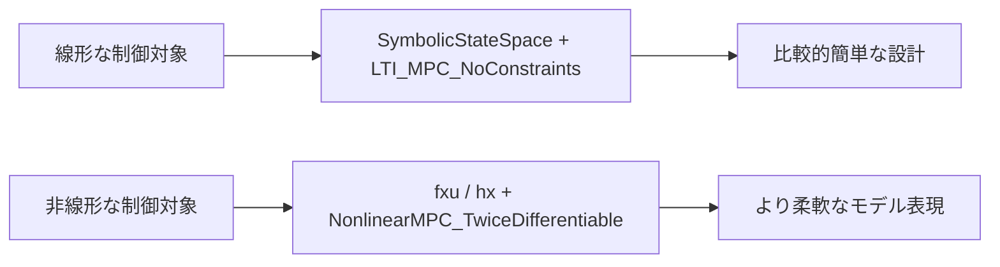

# 3. 非線形MPCの使い方

非線形MPCの典型例は `sample/nonlinear/simple_pendulum.py` にあります。

ここでは線形MPCと違って、状態遷移を `f(x, u)` として記述し、観測方程式を `h(x)` として定義します。

## 1. シンボリックモデルを作る

```python
theta, omega, u0, dt, a, b, c, d = sp.symbols(
    'theta omega u0 dt a b c d', real=True)

theta_next = theta + dt * omega
omega_dot = -a * sp.sin(theta) - b * omega + c * \
    sp.cos(theta) * u0 + d * (u0 ** 2)
omega_next = omega + dt * omega_dot

f = sp.Matrix([theta_next, omega_next])
h = sp.Matrix([[theta]])

x_syms = sp.Matrix([[theta], [omega]])
u_syms = sp.Matrix([[u0]])
```

この部分では、振り子の状態方程式を定義しています。

- `theta`: 角度
- `omega`: 角速度
- `u0`: 入力
- `f`: 次状態を決める関数
- `h`: 観測出力

非線形MPCでは、`A/B/C` のような線形表現ではなく、シンボリック式そのものを渡すのが特徴です。

## 2. パラメータを dataclass で持つ

```python
@dataclass
class Parameters:
    a: float = 9.81
    b: float = 0.3
    c: float = 1.2
    d: float = 0.10
    dt: float = 0.05
```

`NonlinearMPC_TwiceDifferentiable` は `parameters_struct` として dataclass を要求します。これは、システムの係数やサンプリング時間などを内部的に参照するためです。

この設計により、制御器を作ったあとでも、パラメータを更新しやすくなっています。

## 3. MPCコントローラを生成する

```python
nmpc = NonlinearMPC_TwiceDifferentiable(
    delta_time=state_space_parameters.dt,
    X=x_syms,
    U=u_syms,
    X_initial=X_initial,
    fxu=f,
    hx=h,
    parameters_struct=state_space_parameters,
    Np=Np,
    Weight_U=Weight_U,
    Weight_X=Weight_X,
    Weight_Y=Weight_Y,
    U_min=U_min,
    U_max=U_max,
    Q_kf=Q_ekf,
    R_kf=R_ekf,
    Number_of_Delay=Number_of_Delay,
)
```

この例で書いている内容を要約すると次のとおりです。

- `X`, `U`: 状態変数と入力変数のシンボリック表現
- `fxu`: 状態遷移式 `x_{k+1} = f(x_k, u_k)`
- `hx`: 出力式 `y = h(x)`
- `Weight_*`: コスト重み
- `U_min`, `U_max`: 入力の上下限
- `Q_kf`, `R_kf`: カルマンフィルタの雑音情報

線形MPCと違い、非線形MPCでは「システムの状態方程式」と「観測式」をそのまま与えることが大事です。

## 4. 実際の制御ループ

```python
u_from_mpc = nmpc.update_manipulation(reference, y_measured)
```

このメソッドの役割は、今の計測値と目標値から「次の入力」を返すことです。

内部では次の処理が行われます。

1. 現在の入力を使って状態推定を更新する
2. 遅延補償を行う
3. 目標軌道を設定する
4. SQPベースで最適化を行う
5. 先頭の入力を返す

つまり、サンプルコードから見れば、線形MPCと同じく「参照値 + 計測値 -> 制御入力」の流れで使えます。

## 5. 実際に使うコツ

### 参考にする関数名を押さえる

非線形MPCでは、以下のような役割が分かれているのがポイントです。

- `create_plant_model()`: 数式モデルを作る
- `Parameters`: パラメータをまとめる
- `NonlinearMPC_TwiceDifferentiable(...)`: コントローラ生成
- `update_manipulation(reference, y_measured)`: 次の入力計算

### 重みの意味

```python
Weight_U = np.array([0.05])
Weight_X = np.array([2.5, 0.5])
Weight_Y = np.array([2.5])
```

- `Weight_U`: 入力の大きさを抑える
- `Weight_X`: 状態の偏差を抑える
- `Weight_Y`: 出力追従を重視する

これは「どこを優先するか」を決める設定です。MPCの設計では、この重みが制御の振る舞いを大きく左右します。

## 6. 使い分けのイメージ



簡単に言うと、線形MPCは「状態方程式が行列で表せる場合」、非線形MPCは「数式表現がそのまま必要な場合」に向いています。

## 7. まとめ

非線形MPCの使い方の大事なポイントは、次の3点です。

- `fxu` で次状態の式を定義する
- `hx` で観測式を定義する
- `update_manipulation(reference, y_measured)` で制御入力を得る

`sample/nonlinear/simple_pendulum.py` は、この3つをすべてやっている典型例です。線形MPCに慣れている読者なら、同じような制御ループの流れに見えるはずです。

[04-simulation-and-signal-usage.md](./04-simulation-and-signal-usage.md)
