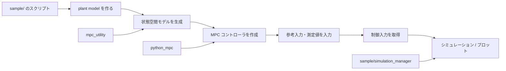

# MPC利用ガイド

このリポジトリは、サンプルコードを起点にして「どのクラスをどう使うのか」を理解できるように設計されています。

本ドキュメントでは、主に以下の利用パターンを説明します。

- 線形システムのMPC: `SymbolicStateSpace` と `LTI_MPC_NoConstraints`
- 非線形システムのMPC: `NonlinearMPC_TwiceDifferentiable`
- シミュレーションとプロット: `SimulationPlotterDash` と `PulseGenerator`

対象は `sample/` フォルダで実際に使われているクラス・関数に絞っています。内部の数式を追うより、まず「どんな入力を渡して、どんな出力を受け取るか」を中心に書きます。

## リポジトリの全体像



## どのドキュメントを読むべきか

| ドキュメント | 主な内容 | 代表的な対象 |
| --- | --- | --- |
| [01-overview.md](./01-overview.md) | このリポジトリで何を作っているか、MPCの流れを理解する | 全体像 |
| [02-linear-mpc-usage.md](./02-linear-mpc-usage.md) | 線形MPCの作り方と使い方 | `SymbolicStateSpace`, `LTI_MPC_NoConstraints` |
| [03-nonlinear-mpc-usage.md](./03-nonlinear-mpc-usage.md) | 非線形MPCの作り方と使い方 | `NonlinearMPC_TwiceDifferentiable` |
| [04-simulation-and-signal-usage.md](./04-simulation-and-signal-usage.md) | 参照入力作成と結果可視化 | `PulseGenerator`, `SimulationPlotterDash` |

## まずはサンプルを読む順番

1. `sample/lti_no_constraints/servo_motor.py`
   - 最も基本的な線形MPCの使い方が見える
2. `sample/nonlinear/simple_pendulum.py`
   - 非線形MPCの流れが見える
3. `sample/simulation_manager/...`
   - 波形の表示方法が見える

## 外部ライブラリとの関係

本リポジトリは、制御や最適化の基盤を外部ライブラリから活用しています。

- `external_libraries/MCAP_python_control` では、状態推定や制御の基本部品を扱う
- `external_libraries/MCAP_python_optimization` では、非線形最適化やSQPの計算を扱う

これにより、このリポジトリでは「制御対象のモデル作成」「MPCの制御則」「可視化」を組み合わせて、すぐに実験できる構成になっています。

## 使い方の基本パターン

```python
# 1. システムを定義する
ideal_plant_model = SymbolicStateSpace(A, B, C, delta_time=dt)

# 2. 重みとホライズンを定義する
Weight_U = np.diag([0.001])
Weight_Y = np.diag([1.0, 0.005])
Np = 20
Nc = 2

# 3. MPCコントローラ生成
mpc = LTI_MPC_NoConstraints(ideal_plant_model, Np=Np, Nc=Nc,
                           Weight_U=Weight_U, Weight_Y=Weight_Y)

# 4. 制御ループで使用
reference = np.array([[0.8], [0.0]])
U = mpc.update(reference, y_measured)
```

実際のサンプルでは、この流れを繰り返し実行して、時間ごとの入力・出力・状態を観測しています。

次に進むには、まず [01-overview.md](./01-overview.md) を読むのがおすすめです。
